# QualyQuest SGQ & Rooster MRO

**Plataforma Corporativa Integrada de Sistema de Garantia da Qualidade (SGQ), Gestão de Competências Aeronáuticas (Rooster MRO), Controle Documental e Reutilização Inteligente de Requisitos em Auditorias.**

<p align="center">
  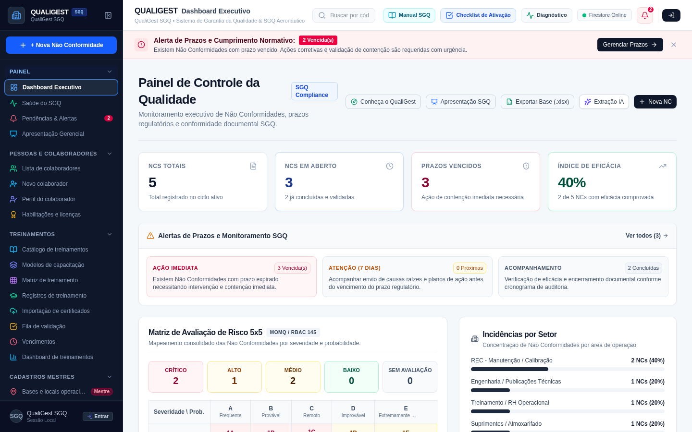
</p>

---

## Sumário

1. [Identificação do Sistema](#1-identificação-do-sistema)
2. [Finalidade e Contexto Aeronáutico / MRO](#2-finalidade-e-contexto-aeronáutico--mro)
3. [Problemas Operacionais Resolvidos](#3-problemas-operacionais-resolvidos)
4. [Funcionalidades Implementadas](#4-funcionalidades-implementadas)
5. [Módulos e Navegação Unificada](#5-módulos-e-navegação-unificada)
6. [Base Institucional de Requisitos, Respostas e Evidências (177+)](#6-base-institucional-de-requisitos-respostas-e-evidências-177)
7. [Importação de Novas Auditorias e Pré-Auditoria Consolidada](#7-importação-de-novas-auditorias-e-pré-auditoria-consolidada)
8. [Gestão de Colaboradores, Competências, Treinamentos e Qualificações](#8-gestão-de-colaboradores-competências-treinamentos-e-qualificações)
9. [Controle de Validades e Alertas](#9-controle-de-validades-e-alertas)
10. [Controle Documental e Consulta Temporal](#10-controle-documental-e-consulta-temporal)
11. [Relatórios, Dashboards e Apresentações PPTX](#11-relatórios-dashboards-e-apresentações-pptx)
12. [Inventário Documentado dos Arquivos PPTX](#12-inventário-documentado-dos-arquivos-pptx)
13. [Integrações e APIs Existentes](#13-integrações-e-apis-existentes)
14. [Inteligência Artificial (Gemini) e Fallbacks](#14-inteligência-artificial-gemini-e-fallbacks)
15. [Perfis de Acesso (RBAC) e Regras Firestore](#15-perfis-de-acesso-rbac-e-regras-firestore)
16. [Arquitetura Técnica Real](#16-arquitetura-técnica-real)
17. [Banco de Dados, Persistência e Evidence Storage](#17-banco-de-dados-persistência-e-evidence-storage)
18. [Variáveis de Ambiente](#18-variáveis-de-ambiente)
19. [Instalação e Execução Local](#19-instalação-e-execução-local)
20. [Scripts Disponíveis](#20-scripts-disponíveis)
21. [Testes Disponíveis e Situação Real](#21-testes-disponíveis-e-situação-real)
22. [Classificação Objetiva por Funcionalidade](#22-classificação-objetiva-por-funcionalidade)
23. [Limitações Conhecidas](#23-limitações-conhecidas)
24. [Funcionalidades Dependentes de Configuração Externa](#24-funcionalidades-dependentes-de-configuração-externa)
25. [Próximas Etapas / Roadmap](#25-próximas-etapas--roadmap)
26. [Screenshots Reais da Aplicação](#26-screenshots-reais-da-aplicação)
27. [Aviso de Integridade e Anti-Alucinação](#27-aviso-de-integridade-e-anti-alucinação)

---

## 1. Identificação do Sistema

- **Nome da Aplicação:** QualyQuest SGQ & Rooster MRO (`qualigest-rnc` no `package.json`)
- **Organização Principal de Referência:** IMPACTO Aviation (`org_impacto_aviation`)
- **Domínio:** Garantia da Qualidade Aeronáutica, Manutenção de Aeronaves (MRO) e Governança de Auditorias Regulatórias e de Clientes
- **Arquitetura de Operação:** Aplicação Web SPA integrada com servidor backend Node.js/Express, persistência em Google Cloud Firestore e armazenamento de arquivos de evidência em objeto/disco

---

## 2. Finalidade e Contexto Aeronáutico / MRO

O **QualyQuest SGQ & Rooster MRO** sustenta a conformidade operacional e regulatória de organizações de manutenção aeronáutica homologadas ou auditadas sob **ANAC RBAC 145 / RBAC 43**, **EASA Part-145**, **FAA 14 CFR Part 145**, **IOSA** e checklists específicos de clientes e operadores aéreos (como Kalitta Air QA-14, TACV, entre outros).

O sistema integra duas frentes operacionais em uma única plataforma:
1. **Rooster MRO (Sistema de Registro de Efetivo e Competências):** Cadastro canônico de colaboradores técnicos, licenças CHT/CANAC, autorizações de retorno ao serviço (APRS/RTS), catálogos de treinamentos por frota e motor, matrizes de capacitação e bases operacionais.
2. **QualyQuest SGQ (Garantia da Qualidade e Auditorias):** Gestão de Não Conformidades (Formulário F 001-29), Matriz de Risco 5x5, Ishikawa 6M, Planos 5W2H, Controle Documental com Consulta Temporal na data da Ordem de Serviço, Metrologia (RBC/Inmetro), **Base Institucional de 177+ Requisitos** e **Pré-Auditoria Consolidada** com reuso inteligente entre auditorias.

---

## 3. Problemas Operacionais Resolvidos

| Problema Operacional | Risco / Impacto | Solução Implementada no Sistema |
| :--- | :--- | :--- |
| **Retrabalho a cada nova auditoria** | Equipe da Qualidade recomeça do zero respostas e levantamentos já realizados em auditorias anteriores. | **Base Institucional Permanente (177+ requisitos)** combinada com **Pré-Auditoria Consolidada**, que compara automaticamente checklists recebidos contra respostas aprovadas e evidências vigentes. |
| **Reutilização indevida fora de escopo** | Usar resposta de um cliente/base/aeronave sem validar diferenças regulatórias ou operacionais. | Motor de comparação separa explicitamente `EQUIVALÊNCIA CONFIRMADA` de `EQUIVALÊNCIA PARCIAL` sempre que houver divergência de cliente, localidade, frota, norma ou evidência vencida. |
| **Presunção arbitrária de validades de cursos** | Suposição manual de prazos sem regra de catálogo. | **Motor estrito de 5 estados de validade** calculado por meses reais de calendário ou data explícita, sem inventar vencimentos. |
| **Uso ou citação de manuais obsoletos** | Não conformidade por falta de comprovação da revisão vigente na data da OS. | **Consulta Temporal na Data da OS** e alertas automáticos de impacto quando revisões documentais mudam ou documentos são inativados. |
| **Silos entre Qualidade, Treinamentos, Metrologia e Documentos** | Respostas de auditoria desconectadas de laudos, treinamentos e RNCs reais. | Consulta cruzada em tempo real (`consultarRegistrosRelacionadosSGQ`) conectando documentos controlados, manuais, treinamentos, CHTs, ferramentas calibradas e RNCs. |

---

## 4. Funcionalidades Implementadas

- **Base Institucional de Requisitos, Respostas e Evidências (177+ requisitos reais):** Edição individual, consulta cruzada ao SGQ, vínculo com controles internos e documentos (MOMQ, PTM, POP, IT), gestão de lacunas, validação humana obrigatória, trilha de versões e detecção contínua de impactos sem sobrescrever respostas aprovadas.
- **Importação de Auditorias e Pré-Auditoria Consolidada:** Extração de checklists (Excel, CSV, PDF, texto/DOCX), preservação *ipsis litteris* da redação original, comparação semântica e contextual contra a Base Institucional, geração de pré-auditoria persistida, adaptação por auditoria sem contaminar a base mestra, **Snapshots Imutáveis** e **Incorporação Pós-Auditoria** aprovada pela Qualidade.
- **Gestão de Não Conformidades (RNC F 001-29):** Fluxo completo com numeração auditável, Matriz de Risco 5x5, Causa Raiz (Ishikawa 6M e 5 Porquês), Planos de Ação 5W2H e verificação de eficácia.
- **Rooster MRO (Pessoas, Competências e Treinamentos):** Dossiê completo de mecânicos e inspetores, licenças CHT, designações técnicas (F 001-29), autorizações por frota (APRS), catálogo de 15 cursos técnicos, matrizes de capacitação, fila de validação de certificados e central de vencimentos/gaps.
- **Controle Documental & Consulta Temporal:** Cadastro de publicações controladas, controle de revisões vigentes, solicitações de revisão a clientes/fabricantes, comparador de revisões e apuração histórica por data da Ordem de Serviço.
- **Ferramentas & Metrologia:** Controle de equipamentos calibrados (RBC/Inmetro), conta de créditos de calibração e identificação de instrumentos vencidos ou em quarentena.
- **Apresentação Gerencial 70/30 e Exportação PPTX:** Visualização web interativa e geração automatizada de apresentações PowerPoint widescreen (`PptxGenJS`).
- **Importação Inteligente e Extrator de NCs:** Importação assistida de planilhas em 4 etapas com prévia e reversão e extração estruturada de documentos.

---

## 5. Módulos e Navegação Unificada

Toda a navegação é centralizada em `src/config/navigationRegistry.ts` (`NAV_GROUPS`), eliminando entradas duplicadas entre menu lateral, títulos de página, navegação móvel e roteamento interno (`AppViewRouter.tsx`). A estrutura oficial conta com **8 grupos canônicos** e **45 itens únicos**:

1. **Painel:** Dashboard Executivo (`dashboard`), Saúde do SGQ (`saudeSGQ`), Pendências & Alertas (`alertas`), Apresentação Gerencial (`apresentacao`).
2. **Pessoas e Colaboradores:** Colaboradores & Perfis (`pessoas-competencias`), Novo Colaborador (`colaborador-novo`), Habilitações e Licenças (`cht-qualificacoes`), Lista de Designação Técnica (`rooster-designacao`), Designações & Frotas APRS (`rooster-designacoes-crud`).
3. **Treinamentos:** Catálogo de Treinamentos (`rooster-catalogo`), Matriz & Capacitação (`rooster-matrizes`), Registros de Treinamento (`treinamentos-qualificacoes`), Importação de Certificados (`importacao-certificados`), Fila de Validação de Certificados (`validacao-treinamentos`), Central de Vencimentos & Gaps (`central-vencimentos-gaps`), Dashboard de Treinamentos (`competencias-dashboard`).
4. **Cadastros Mestres:** Bases e Locais Operacionais (`cadastros-bases`), Funções e Cargos (`cadastros-funcoes-cargos`), Motores & Frotas (`rooster-motores`).
5. **Qualidade e Auditorias:** Não Conformidades RNC (`relatorio`), Análise & Indicadores (`incidencias`), Validação & Aprovação RNC (`validacao-qualidade`), Auditorias Internas & Externas (`auditorias-gestao`), **Base Institucional (177 Req.) (`preparacao-auditorias`)**, **Auditoria Inteligente & Pré-Auditoria (`smart-audit`)**, Requisitos de Clientes & Matriz (`clientes-requisitos`), Checklists de Auditoria (`biblioteca-checklists`), Biblioteca Normativa & Fontes (`biblioteca-requisitos`), Banco de Manuais IA (`manuais`), Controle Documental & Revisões (`controle-documental`), Ferramentas & Metrologia (`ferramentas-metrologia`).
6. **Relatórios:** Relatório do Roster (`rooster-relatorio`), Dossiê Oficial F 001-29 (`oficial`), Constatações & Lições (`auditorias-constatacoes`), Conferência de Frota & Turno (`rooster-conferencia`).
7. **Administração e Segurança** *(acesso restrito a `ADMIN` / `ADMINISTRADOR` / `GESTOR_SGQ`)*: Usuários & Permissões RBAC (`admin-central`), Configurações & Parâmetros (`configuracoes-org`), Audit Trail do Sistema (`admin-audit-trail`), System Designer ADRs (`system-designer`), Diagnósticos Técnicos (`diagnosticos-tecnicos`), Implantação & Onboarding (`onboarding-novo-cliente`).
8. **Ferramentas e Conhecimento:** Importação Inteligente de Dados (`importacao-inteligente`), Extrator de NCs com IA (`extrator`), Base de Conhecimento SGQ (`knowledgeBase`), Manual de Utilização (`manual-utilizacao`).

> **Aliases legados preservados sem duplicação no menu:** identificadores históricos como `rooster-ficha`, `pre-auditoria`, `consulta-temporal`, `validacaoQueue`, `modelos-capacitacao` e `tour-interativo` redirecionam diretamente ao módulo canônico correspondente com abertura na subaba correta.

---

## 6. Base Institucional de Requisitos, Respostas e Evidências (177+)

O módulo **Base Institucional (177 Req.)** (`preparacao-auditorias` / coleção `audit_readiness_preparations`) permite à equipe da Qualidade tratar individualmente os **177 requisitos originais** (`MASTER_CHECKLIST_ITEMS`) e os novos requisitos incorporados após auditorias:

- **Origem e Rastreabilidade:** Exibe fonte, autoridade/cliente, norma, seção, revisão, controle central SGQ e tipo de origem (`BASE_INICIAL_177` ou `INCORPORADO_POS_AUDITORIA`).
- **Redação Original Intacta:** O campo `textoOriginal` é preservado sem edição destrutiva para referência auditável.
- **Consulta Cruzada aos Módulos do SGQ (`consultarRegistrosRelacionadosSGQ`):** Ao abrir um requisito, o sistema consulta ao vivo documentos controlados (MOMQ, PTM, POP, IT), manuais normativos, registros de treinamento, qualificações/CHTs, ferramentas calibradas (Metrologia), RNCs abertas/encerradas e evidências cadastradas, apontando objetivamente as **lacunas reais de documentação ou comprovação** sem inventar fontes inexistentes.
- **Proposta Assistida e Validação Humana (Human-in-the-Loop):** Permite gerar rascunho fundamentado exclusivamente nas fontes reais vinculadas, anexar evidências com data de validade e submeter para aprovação formal da liderança da Qualidade (`statusResposta: 'APROVADA'`), registrando responsável, parecer, data, versão e histórico imutável de alterações.
- **Monitoramento Contínuo de Impactos (`detectarImpactosBaseInstitucional`):** Quando um documento vinculado muda de revisão/status, uma evidência vence (ou entra nos próximos 30 dias), uma ferramenta entra em quarentena/vencimento ou surge RNC crítica relacionada, o requisito recebe a sinalização não destrutiva **`reavaliacaoNecessaria: true`** com os motivos detalhados e a referência congelada da última versão aprovada (`ultimaRespostaAprovadaSnapshot`), sem apagar ou sobrescrever o texto aprovado anteriormente.

---

## 7. Importação de Novas Auditorias e Pré-Auditoria Consolidada

Na aba **Auditoria Inteligente & Pré-Auditoria** (`smart-audit` / `PreAuditWorkspaceView`), o fluxo para novas auditorias segue etapas auditáveis:

1. **Importação e Leitura do Checklist:** Importação de documentos/planilhas com identificação de número do item, capítulo/seção, referência normativa e **preservação integral (*ipsis litteris*) da redação original** de cada requisito (`textoOriginalRequisito`).
2. **Comparação Semântica e Contextual (`analisarAuditoriaContraBaseInstitucional`):** Cada requisito importado é comparado contra todos os requisitos da Base Institucional (os 177 iniciais + requisitos incorporados posteriormente) combinando análise conceitual bilíngue PT/EN de domínio aeronáutico (metrologia, CHT/treinamento, recebimento/quarentena/shelf-life, dados técnicos, CRS/RII, FOD/EHS, NDT, SGQ/SMS, roster, químicos), sobreposição lexical normalizada e correspondência de cláusulas normativas.
3. **Classificação Obrigatória em 4 Categorias:**
   - **`EQUIVALÊNCIA CONFIRMADA`**: Requisito semanticamente equivalente localizado na base, com resposta institucional `APROVADA`, escopo compatível (cliente, localidade, frota, norma), ausência de alertas de reavaliação e evidências vigentes aplicáveis.
   - **`EQUIVALÊNCIA PARCIAL`**: Correspondência identificada com resposta base aprovada, porém exigindo adaptação ou complementação devido a diferença de cliente/operador (ex.: requisitos de GMM específico), base/localidade, aeronave, norma regulatória, evidência vencida/ausente ou alerta pendente na base.
   - **`REQUISITO SEM RESPOSTA APROVADA`**: Requisito correlacionado existente na base institucional cujo tratamento ainda está em `NAO_INICIADA`, `RASCUNHO`, `EM_ELABORACAO` ou `AGUARDANDO_VALIDACAO`.
   - **`NOVO REQUISITO`**: Nenhuma equivalência suficiente encontrada na Base Institucional; tratado como item novo na auditoria.
4. **Separação Estrita (Base Institucional vs. Adaptação da Auditoria):** A visualização apresenta lado a lado a **Resposta Institucional Base (somente leitura)** e o campo de **Resposta Adaptada para a Auditoria Atual**. Editar a resposta para uma auditoria específica **jamais** altera a resposta institucional permanente.
5. **Persistência e Snapshots Imutáveis:** A pré-auditoria consolidada é gravada em `organizations/{orgId}/pre_audits/{preAuditId}` com possibilidade de gerar **Snapshots Imutáveis** (`PreAuditSnapshot`, append-only protegido nas regras do Firestore) registrando data, responsável e fotografia integral dos itens no momento do congelamento.
6. **Incorporação Controlada Pós-Auditoria:** Itens classificados como `NOVO REQUISITO` podem ser incorporados permanentemente à Base Institucional (`incorporarRequisitoNaBaseInstitucional`), ação restrita por RBAC à liderança da Qualidade (`ADMIN`, `ADMINISTRADOR`, `GESTOR_SGQ`, `GESTOR`) e protegida contra duplicidades.

---

## 8. Gestão de Colaboradores, Competências, Treinamentos e Qualificações

- **Cadastro Técnico Canônico (`/persons`):** Controle de matrícula, código CANAC, base operacional, especialidade (CEL, GMP, AVI), status operacional (`ATIVO`, `EM_TREINAMENTO`, `RESTRITO`, `SUSPENSO`, `AFASTADO`, `INATIVO`, `DESLIGADO`, `STATUS_NAO_INFORMADO`) e vínculos históricos.
- **Habilitações, CHTs e APRS/RTS:** Controle de carteiras ANAC, licenças e autorizações por frota e escopo de manutenção, incluindo Lista de Designação Técnica vinculada ao formulário **F 001-29**.
- **Catálogo de Cursos & Matrizes:** 15 cursos técnicos estruturados no catálogo inicial (EWIS, FTS Fase 2, Fatores Humanos, Recebimento/SUPs, Torqueamento AC 43.13-1B, Ensaio por Líquido Penetrante, e níveis Nível 1/2/3 para A320, A330, B737, B777 e ATR 42/72) com carga horária, modalidade e regras explícitas de recorrência.
- **Fila de Validação & Certificados:** Importação em lote e fila de homologação técnica dos registros de treinamento.

---

## 9. Controle de Validades e Alertas

- **Motor de 5 Estados de Validade:**
  1. `Sem vencimento aplicável` (exclusivo para cursos marcados explicitamente com `recorrente: false` / permanente);
  2. `Sem validade definida` (ausência de regra explícita no catálogo — nunca assumida como vitalícia);
  3. `Dados insuficientes` (ausência de data de realização ou dado mandatório);
  4. `Em dia` (validade futura calculada por meses reais de calendário ou data explícita);
  5. `Vencido` (prazo expirado na data de referência).
- **Central de Vencimentos & Gaps:** Classificação automática por janelas de criticidade (vencidos, ≤30 dias, ≤60 dias, ≤90 dias).
- **Alertas na Base Institucional e Metrologia:** Detecção automática de evidências vencidas ou a vencer em 30 dias, revisões documentais alteradas e instrumentos fora da validade de calibração.

---

## 10. Controle Documental e Consulta Temporal

- **Acervo Controlado (`controlled_documents` / `document_revisions`):** Gestão de MOMQ, PTM, AMM, CMM, MPM e instruções internas com unicidade controlada de códigos e revisões.
- **Consulta Temporal na Data da OS:** Permite selecionar uma data histórica de execução de Ordem de Serviço para apurar exatamente qual revisão do manual estava aprovada e vigente naquela data.
- **Solicitações Externas e Comparador de Revisões:** Fluxos de controle para consulta a fontes públicas, notificações de revisão a clientes/fabricantes e comparação entre versões.

---

## 11. Relatórios, Dashboards e Apresentações PPTX

- **Dashboards Executivos:** Painel geral SGQ, Saúde do SGQ, Análise de Incidências (Pareto / Setores), Dashboard de Competências e Painel de Prontidão dos 177+ requisitos.
- **Relatórios Operacionais:** Dossiê Oficial F 001-29, Relatório Oficial do Roster (exportação A4 e Excel/XLSX), Constatações & Lições Aprendidas e Conferência de Frota & Turno.
- **Apresentação Gerencial 70/30:** Geração em tela web e exportação para `.pptx` widescreen (16:9) via `PptxGenJS` com controle de layout e paginação.

---

## 12. Inventário Documentado dos Arquivos PPTX

O levantamento integral, com hashes SHA-256, contagem real de slides/notas e metadados XML extraídos diretamente dos binários, está registrado em **[docs/INVENTARIO_TREINAMENTOS_PPTX.md](docs/INVENTARIO_TREINAMENTOS_PPTX.md)**.

Resumo factual verificado:
- **Total no código-fonte / docs / raiz:** **7 arquivos `.pptx`** (nenhum arquivo `.ppt` legado).
- **Natureza real:** Todos os 7 arquivos são **apresentações gerenciais do SGQ geradas via `PptxGenJS`** (`docs/Apresentacao_Gerencial_QualyQuest_Rooster.pptx` e sua cópia idêntica em `public/Apresentacao_Gerencial_QualyQuest_Rooster.pptx` com 25 slides de 2026-11-03, mais os 5 artefatos de regressão de layout `pptx_1_normal.pptx` a `pptx_5_empty_data.pptx` de 2026-10-16).
- **Treinamentos técnicos em PPTX:** **Não existem** apostilas ou decks técnicos de cursos aeronáuticos em `.pptx` no repositório; o catálogo dos 15 cursos técnicos (`TRN-*`) é mantido em código e Firestore (`src/data/initialCompetenciesData.ts` e coleções `trainingCourses` / `roster_cursos_catalogo`).
- Todos os arquivos `.pptx` existentes foram preservados integralmente sem exclusão.

---

## 13. Integrações e APIs Existentes

O backend Express (`server.ts`, porta `3000`) expõe endpoints HTTP ativos para o frontend:

- **Saúde e Observabilidade:** `GET /api/health`, `GET /api/gemini/metrics`, `POST /api/gemini/cache/clear`.
- **Análise de RNCs e Documentos:** `POST /api/extract-document-text`, `POST /api/extract-nc`, `POST /api/ai-suggest`, `POST /api/evaluate-root-cause-coherence`, `POST /api/audit-compliance`, `POST /api/match-rnc`, `POST /api/compare-rnc`, `POST /api/generate-knowledge-pattern`, `POST /api/suggest-sector`, `POST /api/audit-assist`.
- **Manuais e Acervo IA:** `POST/GET /api/manual-files/:manualId`, `POST /api/parse-manual`, `POST /api/consult-manuals`, `GET/POST /api/manuals/schema-json`, `/api/manuals/validate-json`, `/api/manuals/upload-json`, `/api/manuals/ingest-pipeline`, `/api/manuals/tasks*`, `/api/manuals/:docId/fragments`, `/api/manuals/:docId/coverage-report`, `/api/manuals/enquadrar-nc`, `/api/manuals/compare-revisions`, `/api/manuals/stats`.
- **Smart Import & Smart Audit:** `POST /api/smart-import/analyze`, `POST /api/smart-import/parse-file`, `POST /api/smart-audit/parse-checklist`, `POST /api/smart-audit/parse-document`, `POST /api/smart-audit/evaluate-checklist-item`, `POST /api/smart-audit/assist-requirement-response`, `POST /api/smart-audit/suggest-resolution`.
- **Controle Documental & Fontes Externas:** `POST /api/documentos/verificar-fontes-publicas`, `POST /api/documentos/notificar-cliente-revisao`, `POST /api/documentos/solicitar-fabricante-revisao`, `POST /api/documentos/relatorio-conformidade`, `POST /api/documentos/auditoria-duplicidades`.
- **Evidence Storage (`/api/evidence/*`):** Upload, download autenticado e remoção de arquivos binários de evidências com registro de auditoria (`server/evidenceStorageRouter.ts`).
- **Conectores Impacto MRO Connect:** `GET /api/impacto/health`, `/api/impacto/status`, `/api/impacto/bases`, `/api/impacto/tecnicos`, `/api/impacto/tecnicos/:id`, `/api/impacto/qualificacoes`, `/api/impacto/treinamentos`, `/api/impacto/ferramentas`, `/api/impacto/ferramentas/:id`, `/api/impacto/ordens-servico`, `/api/impacto/ordens-servico/:id`, `/api/impacto/ordens-servico/:id/contexto-qualidade` *(operam com dados reais via `IMPACTO_MRO_API_URL` + `IMPACTO_MRO_API_KEY` quando configurados; sem URL externa, respondem com status explícito de conector não configurado ou fallback estrutural local).*

---

## 14. Inteligência Artificial (Gemini) e Fallbacks

- A SDK `@google/genai` é utilizada **exclusivamente no backend (`server.ts` e `server/gemini/*`)** mediante `process.env.GEMINI_API_KEY`, sem exposição de chave no cliente.
- As rotinas de extração documental, sugestão de análise causal, comparação de checklists e assistência de resposta possuem **fallback heurístico / determinístico** quando `GEMINI_API_KEY` não está configurada ou em contingência de rede.
- A validação de equivalência contra a Base Institucional (`preAuditMatchingService.ts`) e as sugestões baseadas em fontes reais (`sugerirRespostaBaseadaEmFontes`) executam regras determinísticas e semânticas auditáveis com **bloqueio estrito contra invenção de evidências**.

---

## 15. Perfis de Acesso (RBAC) e Regras Firestore

As regras declaradas em `firestore.rules` aplicam isolamento multi-tenant (`organizations/{organizationId}/*`) e controle por perfil:

| Perfil | Escopo de Acesso Efetivo |
| :--- | :--- |
| **`ADMIN` / `ADMINISTRADOR`** | Leitura e escrita irrestrita no tenant, administração de usuários/convites, exclusão autorizada, aprovação permanente na Base Institucional e congelamento de Pré-Auditorias. |
| **`GESTOR_SGQ` / `GESTOR`** | Criação, edição e aprovação formal de RNCs, manuais, documentos controlados, requisitos da Base Institucional (`APROVADA` / `PRONTO_PARA_AUDITORIA`), incorporação permanente de novos requisitos e finalização de Pré-Auditorias (`PRONTA_PARA_AUDITORIA` / `FINALIZADA_CONGELADA`). |
| **`AUDITOR`** | Leitura completa no tenant, registro de constatações, lançamentos operacionais e preparação de pré-auditorias em elaboração; **sem** permissão para autoaprovar requisitos institucionais permanentes (`APROVADA`), alterar RBAC ou excluir registros críticos. |
| **`CONSULTA` / `VIEWER`** | Leitura restrita ao próprio tenant; **bloqueado para criação, edição ou exclusão** em coleções operacionais, Base Institucional, evidências e Pré-Auditorias. |

- Coleções `auditTrails` são estritamente **append-only** (`update, delete: if false`).
- Em `pre_audits`, as regras impedem redução ou remoção do array histórico `snapshots` em atualizações (`incoming().snapshots.size() >= existing().snapshots.size()`).

---

## 16. Arquitetura Técnica Real

- **Frontend:** React 19 + TypeScript (`~5.8.2`), empacotado com Vite 6.
- **Estilização:** Tailwind CSS v4 (`@tailwindcss/vite`) e ícones `lucide-react`.
- **Backend Integrado:** Node.js + Express 4 executando `server.ts` via `tsx` em desenvolvimento (com `vite.middlewares` na porta `3000`) e bundle CJS via `esbuild` para produção (`dist/server.cjs`).
- **Banco de Dados e Auth:** Firebase 12 (Authentication + Cloud Firestore com listeners `onSnapshot`).
- **Processamento de Arquivos e Documentos:** `pdf-parse`, `mammoth` (DOCX), `xlsx` (planilhas), `jspdf`, `html2canvas`, `pptxgenjs`, `recharts`.

---

## 17. Banco de Dados, Persistência e Evidence Storage

- **Cloud Firestore:** Fonte de verdade multi-tenant sob `/organizations/{organizationId}/...`, incluindo `nonConformities`, `persons`, `trainingCourses`, `trainingRecords`, `qualifications`, `controlled_documents`, `document_revisions`, `manuals`, `calibrated_tools`, `externalAudits`, `auditFindings`, `auditRequirements`, **`audit_readiness_preparations`**, **`evidence_files`**, **`pre_audits`** e `auditTrails`.
- **Schema Oficial:** Documentado em `firebase-blueprint.json` e regras correspondentes em `firestore.rules`.
- **Armazenamento de Evidências Binárias:** Controlado por `EVIDENCE_STORAGE_BACKEND` em `server.ts`:
  - **Modo padrão atual quando não configurado (`local`):** `LocalEphemeralStorageBackend` gravando em `/data/evidence_storage/<orgId>/*.bin` + `*.meta.json` com log em `/data/evidence_storage/_audit/evidence_storage_audit.jsonl`.
  - **Modo produção (`gcs`):** `GcsStorageBackend` apontando para bucket provisionado em Google Cloud Storage (`EVIDENCE_STORAGE_BUCKET`).

---

## 18. Variáveis de Ambiente

Base definidas em `.env.example` e esperadas pelo servidor/cliente:

```env
# Armazenamento de Evidências Binárias ('gcs' para produção ou vazio para modo local efêmero)
EVIDENCE_STORAGE_BACKEND=
EVIDENCE_STORAGE_BUCKET=

# Chaves e credenciais Firebase / GCP (server-side)
FIREBASE_API_KEY=
GOOGLE_APPLICATION_CREDENTIALS=

# Integração opcional com ERP/MRO externo (Impacto MRO Connect)
IMPACTO_MRO_API_KEY=
IMPACTO_MRO_API_URL=

# Opcional: Chave Gemini exclusiva no servidor (ativação de parsing/sugestões com LLM)
GEMINI_API_KEY=
PORT=3000
```

> A configuração do Firebase Web Client para o projeto encontra-se em `firebase-applet-config.json` (carregada por `src/services/firebase/config.ts`).

---

## 19. Instalação e Execução Local

```bash
# 1. Instalar dependências
npm install

# 2. Copiar variáveis de ambiente (ajuste conforme necessário)
cp .env.example .env

# 3. Iniciar aplicação em desenvolvimento (Frontend + API Express na porta 3000)
npm run dev

# 4. Verificação de tipos TypeScript
npm run lint

# 5. Build de produção (Vite + esbuild do server.ts)
npm run build

# 6. Executar servidor em produção
npm run start
```

---

## 20. Scripts Disponíveis

### Scripts definidos em `package.json`
- `npm run dev` — Inicia `tsx server.ts` com middlewares Vite na porta `3000`.
- `npm run build` — Compila frontend (`vite build`) e backend (`esbuild server.ts ... --outfile=dist/server.cjs`).
- `npm run start` — Executa `node server.ts` em produção.
- `npm run clean` — Remove `dist/` e `server.js`.
- `npm run lint` — Executa `tsc --noEmit` (checagem estrita de tipos).
- `npm run test:integration` — Executa a suíte `scripts/test_integration_qualyquest_rooster.ts`.

### Scripts operacionais e de verificação em `scripts/`
- `scripts/test_integration_qualyquest_rooster.ts` — Suíte integrada em 11 eixos (Segurança Firestore, Persistência, Validade 5 Estados, Navegação, Integridade Referencial, Importação, Merge Engine e Resiliência).
- `scripts/generate_official_pptx.ts` e `scripts/homologation-fase12-3.ts` — Geração oficial e verificação geométrica PPTX.
- `scripts/migrate_evidences_to_gcs.ts` — Script utilitário de migração do Evidence Storage local para GCS.
- `scripts/test_fase_1_4_3_verification.ts` a `scripts/test_fase_1_4_7_persistent_storage.ts`, `scripts/operational_validation_fase_1_4_4.ts`, `scripts/playwright_fase_1_4_6_visual.ts` — Scripts históricos de verificação de fases anteriores.

---

## 21. Testes Disponíveis e Situação Real

Resultados observados na execução real durante esta revisão:

| Verificação / Suíte | Comando | Resultado Real Medido |
| :--- | :--- | :--- |
| **Compilação TypeScript** | `npm run lint` (`tsc --noEmit`) | **PASS — 0 erros** |
| **Build Completo de Produção** | `npm run build` (`vite build` + `esbuild`) | **PASS — Compilação Vite + Server concluída** |
| **Suíte de Integração QualyQuest & Rooster (11 eixos)** | `npm run test:integration` | **PASS — 163 / 163 aprovados (0 falhas)** (Eixo 1: 18/18, Eixo 2: 6/6, Eixo 3: 12/12, Eixo 4 Navegação: 41/41, Eixo 5: 10/10, Eixo 6: 16/16, Eixo 7: 12/12, Eixo 8: 11/11, Eixo 9: 11/11, Eixo 10: 11/11, Eixo 11: 15/15) |
| **Validação Lógica Base Institucional (177+) & Pré-Auditoria** | Execução direta via `tsx` sobre `auditReadinessService.ts` e `preAuditMatchingService.ts` | **PASS** — 177 requisitos carregados, 8 grupos / 45 rotas únicas validadas, 4 classificações e bloqueio de escopo/RBAC/duplicidade verificados, 69 itens Kalitta QA-14 avaliados sem fabricação de aprovação |
| **Firebase Local Emulator (Regras Firestore unitárias)** | `firebase emulators:exec` | **NÃO DISPONÍVEL no contêiner** (ausência de Java Runtime / JRE neste ambiente) |

---

## 22. Classificação Objetiva por Funcionalidade

| Funcionalidade / Módulo | Classificação Objetiva |
| :--- | :--- |
| Navegação unificada (`navigationRegistry.ts`), rotas, aliases e RBAC de menu | `IMPLEMENTADO E DISPONÍVEL` |
| Gestão de Não Conformidades (RNC F 001-29, 5x5, 6M, 5W2H) | `IMPLEMENTADO E DISPONÍVEL` |
| Rooster MRO (Pessoas, CHTs, Catálogo 15 Cursos, Matrizes, F 001-29, Validades 5 Estados) | `IMPLEMENTADO E DISPONÍVEL` |
| Base Institucional (177+ Requisitos), consulta cruzada SGQ e alerta não destrutivo de impacto | `IMPLEMENTADO E DISPONÍVEL` |
| Importação de Auditorias + Motor Semântico + Pré-Auditoria Consolidada + Snapshots Imutáveis + Incorporação Pós-Auditoria | `IMPLEMENTADO E DISPONÍVEL` |
| Controle Documental, Revisões e Consulta Temporal na data da OS | `IMPLEMENTADO E DISPONÍVEL` |
| Inventário Documental PPTX (`docs/INVENTARIO_TREINAMENTOS_PPTX.md`) e Geração Gerencial `.pptx` | `IMPLEMENTADO E DISPONÍVEL` |
| Evidence Storage persistente em nuvem (Google Cloud Storage) | `IMPLEMENTADO, MAS DEPENDENTE DE CONFIGURAÇÃO` |
| Recursos assistidos por modelo LLM (`GEMINI_API_KEY` server-side) | `IMPLEMENTADO, MAS DEPENDENTE DE CONFIGURAÇÃO` |
| Conectores externos Impacto MRO Connect (`/api/impacto/*` com ERP externo) | `IMPLEMENTADO, MAS DEPENDENTE DE CONFIGURAÇÃO` |
| Publicação das regras atualizadas (`firestore.rules`, incluindo `pre_audits`) no projeto Firebase | `IMPLEMENTADO E DISPONÍVEL` |
| Execução local do Firestore Emulator para testes unitários de regras | `NÃO DISPONÍVEL` |
| Materiais didáticos técnicos em `.pptx` para os 15 cursos do catálogo Rooster | `NÃO DISPONÍVEL` |

---

## 23. Limitações Conhecidas

1. **Evidence Storage local em modo padrão:** Sem `EVIDENCE_STORAGE_BACKEND=gcs` e credenciais GCS válidas, uploads de evidências utilizam armazenamento em disco local do contêiner (`/data/evidence_storage`), inadequado para escala multi-instância em produção.
2. **Base de 177 requisitos inicialmente em preparação:** Dos 177 requisitos iniciais semeados a partir do checklist mestre, a maioria inicia em `NAO_INICIADA` ou `EM_ELABORACAO` para que a equipe de Qualidade da IMPACTO elabore, anexe evidências reais e aprove formalmente cada resposta institucional (apenas requisitos previamente homologados em demonstração têm status `APROVADA`).
3. **Ausência de JRE no ambiente de desenvolvimento:** Impossibilita rodar `firebase emulators:exec` localmente; testes de `firestore.rules` dependem de auditoria estática ou execução contra projeto Firebase provisionado.
4. **Comparação semântica determinística sem embeddings externos:** O motor de Pré-Auditoria utiliza correspondência conceitual aeronáutica PT/EN, similaridade lexical e cláusulas normativas; interpretações altamente contextuais exigem revisão humana na triagem de `EQUIVALÊNCIA PARCIAL` e `NOVO REQUISITO`.

---

## 24. Funcionalidades Dependentes de Configuração Externa

- **Google Cloud Storage para Evidências:** requer `EVIDENCE_STORAGE_BACKEND=gcs`, `EVIDENCE_STORAGE_BUCKET` e `GOOGLE_APPLICATION_CREDENTIALS` (ou conta de serviço do runtime).
- **Google Gemini AI:** requer `GEMINI_API_KEY` no ambiente do servidor (`server.ts`). Sem ela, operam os fallbacks heurísticos locais.
- **Impacto MRO Connect (ERP externo):** requer `IMPACTO_MRO_API_URL` e `IMPACTO_MRO_API_KEY`.
- **Persistência e Autenticação Multi-Usuário em Nuvem:** requer projeto Firebase ativo (`firebase-applet-config.json`) com `firestore.rules` publicadas.

---

## 25. Próximas Etapas / Roadmap

- **Curto Prazo (Operação Qualidade IMPACTO):** Tratar e aprovar progressivamente os 177 requisitos da Base Institucional com upload de evidências vigentes e validação formal da Qualidade; validar a importação de novos checklists (ex.: Kalitta QA-14, EASA, ANAC) diretamente na tela de Pré-Auditoria Consolidada.
- **Infraestrutura / Produção:** Provisionar `EVIDENCE_STORAGE_BACKEND=gcs` com bucket dedicado e aplicar `scripts/migrate_evidences_to_gcs.ts` caso existam anexos locais; publicar as regras atualizadas de `firestore.rules` (incluindo `pre_audits`).
- **Médio Prazo:** Integrar ERP/MRO externo via `IMPACTO_MRO_API_URL` e incorporar apostilas didáticas oficiais dos 15 cursos técnicos ao repositório documental controlado.

---

## 26. Screenshots Reais da Aplicação

As capturas abaixo existem em `docs/screenshots/`:

### Painel Executivo (Dashboard SGQ)


### Lista de Colaboradores & Efetivo Técnico (Rooster MRO)
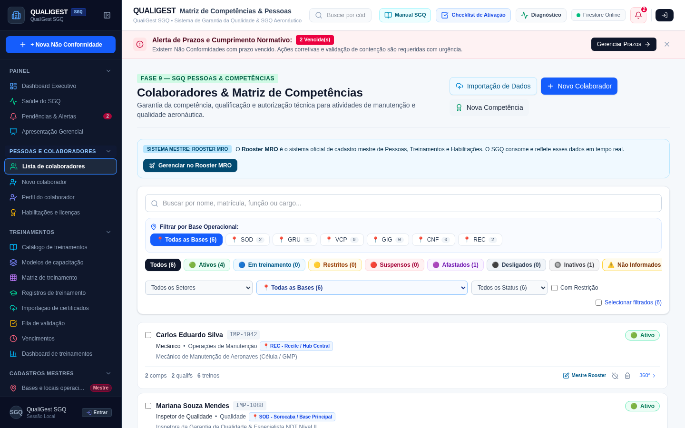

### Ficha / Dossiê do Colaborador
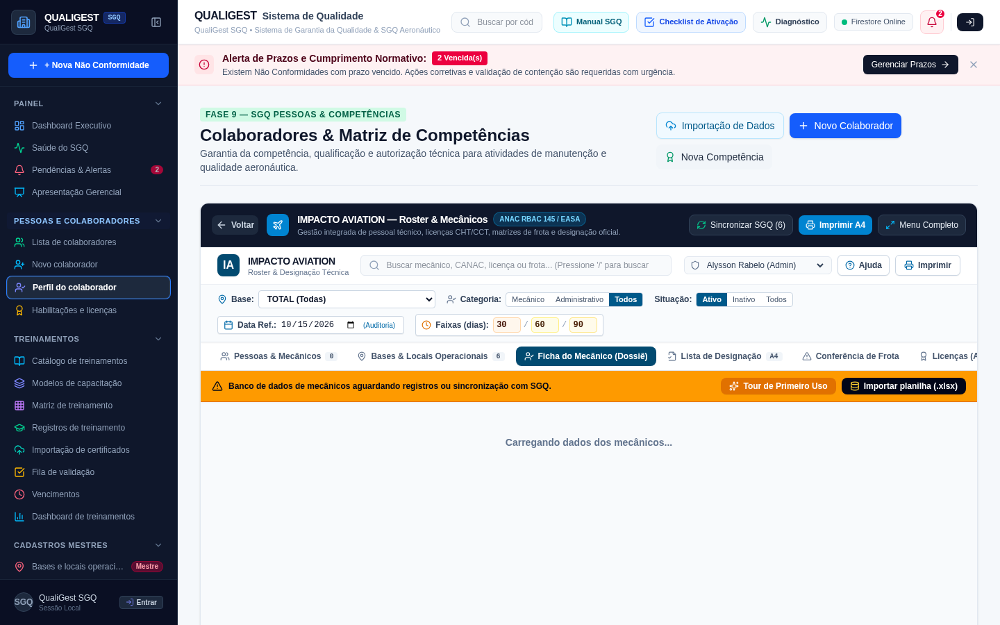

### Registros de Treinamentos & Qualificações
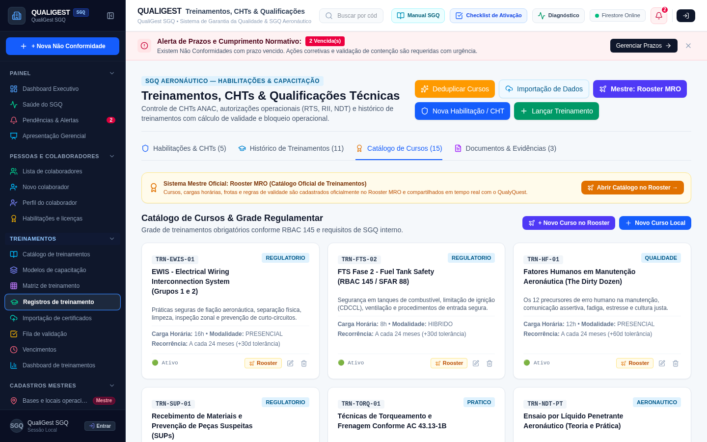

### Catálogo Oficial de Cursos
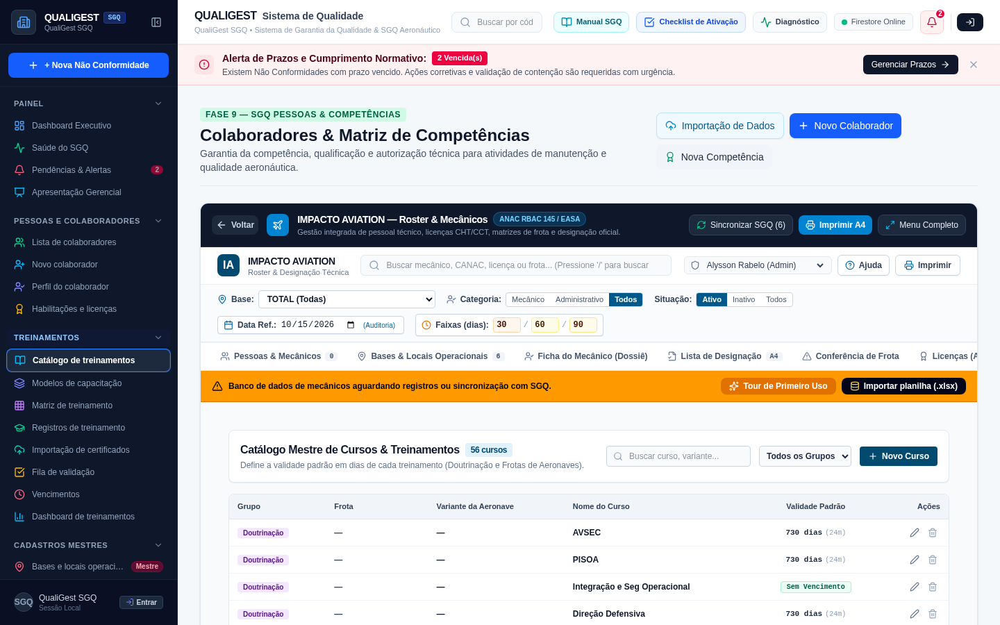

### Matriz de Treinamentos por Frota e Motor
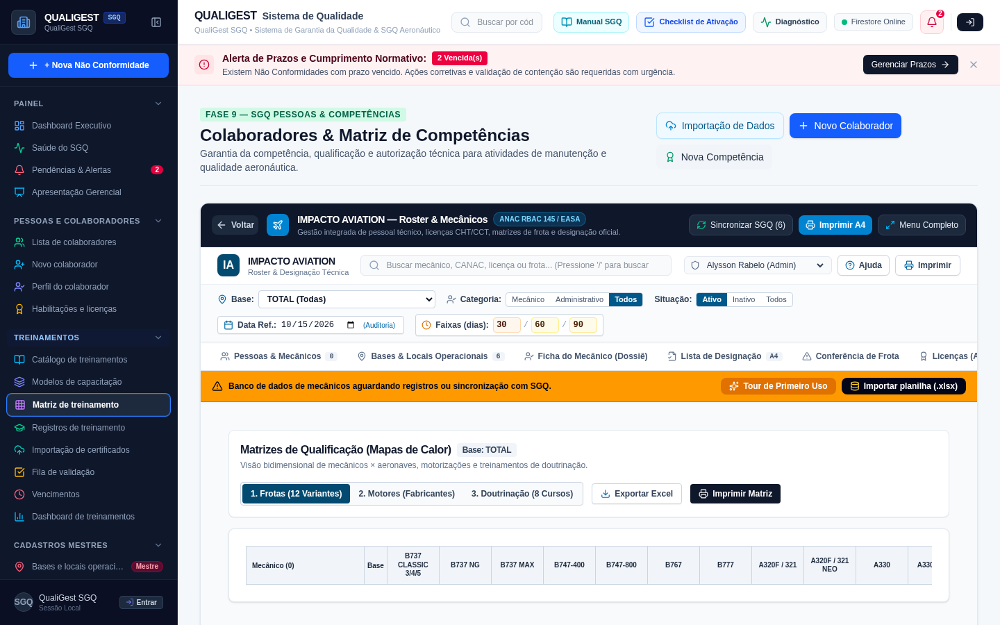

### Modelos de Capacitação Operacional
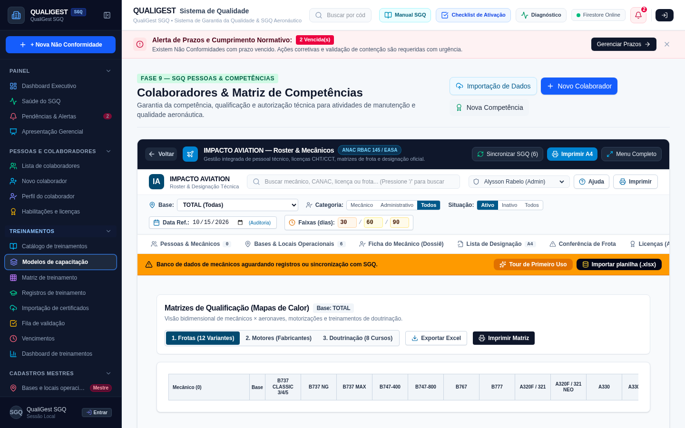

### Central de Vencimentos & Gaps
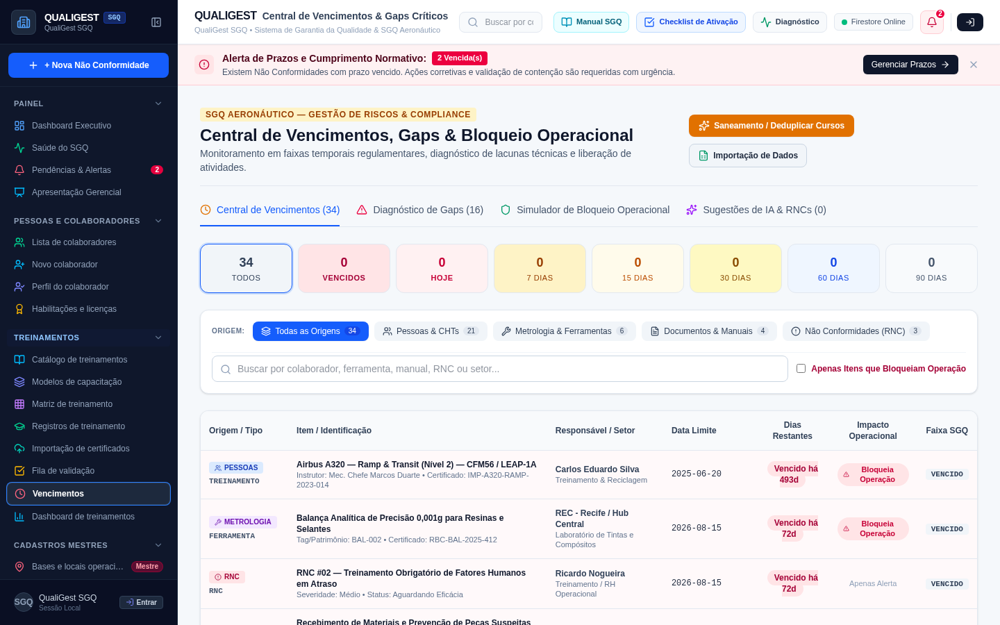

### Bases e Locais Operacionais
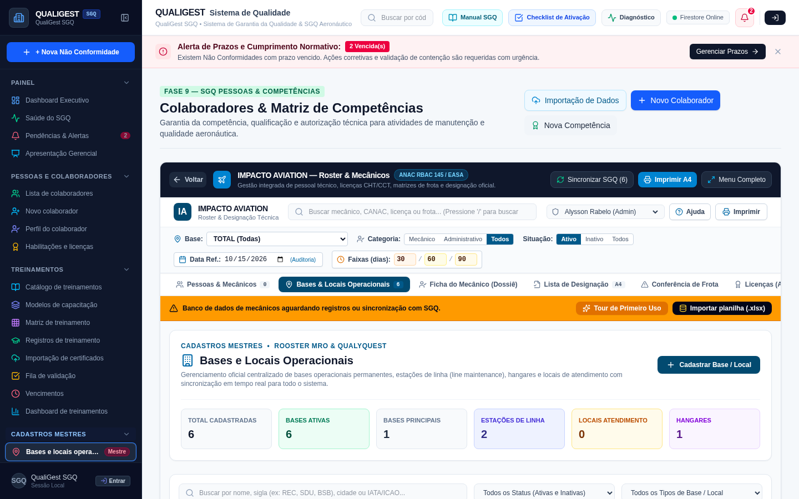

### Gestão de Não Conformidades (RNC F 001-29)
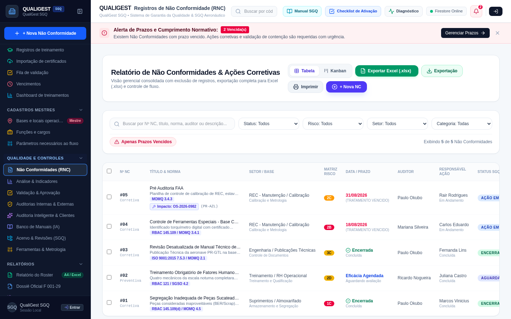

### Controle Documental & Revisões
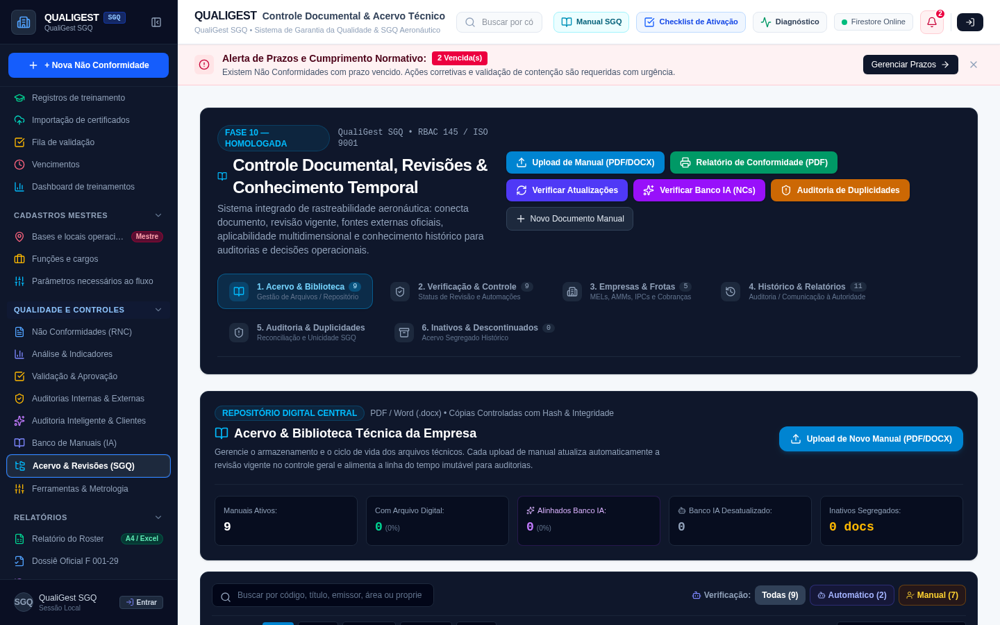

### Apresentação Gerencial (70/30)
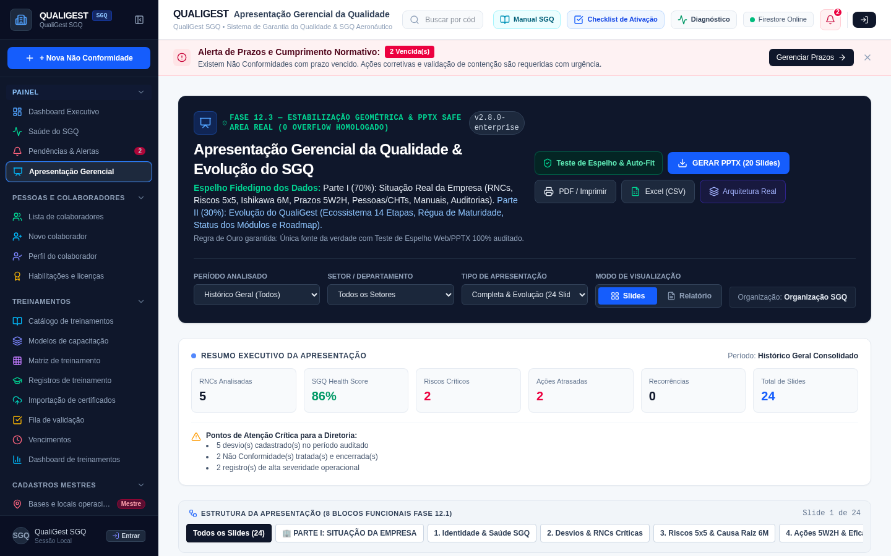

---

## 27. Aviso de Integridade e Anti-Alucinação

Este software opera sob diretriz estrita de integridade regulatória aeronáutica:
- O sistema **não inventa** respostas institucionais aprovadas, documentos controlados, revisões vigentes, treinamentos ou evidências operacionais inexistentes.
- Requisitos sem aprovação formal ou com evidência vencida/ausente **nunca** são classificados como `EQUIVALÊNCIA CONFIRMADA` nem promovidos automaticamente a `PRONTO_PARA_AUDITORIA`.
- Toda aprovação institucional (`APROVADA`), incorporação permanente de novos requisitos à base e congelamento final de pré-auditoria exige decisão humana explícita de perfil autorizado da Qualidade.
