# QualyQuest SGQ & Rooster MRO Enterprise

<div align="center">

[](https://impacto.aero)
[](https://impacto.aero)
[](https://impacto.aero)
[](https://impacto.aero)
[-10b981.svg?style=for-the-badge)](https://impacto.aero)

**A Plataforma Corporativa Unificada de Garantia da Qualidade, Gestão de Competências Técnicas e Governança Regulatória para Centros de Manutenção Aeronáutica (MRO), Oficinas Homologadas e Operadores Aéreos.**

[1. Apresentação](#1-nome-e-apresentação-do-qualyquest--rooster) • [2. Finalidade](#2-finalidade-do-sistema) • [3. Problemas Operacionais](#3-problemas-operacionais-resolvidos) • [4. Funcionalidades](#4-principais-funcionalidades-implementadas) • [5. Módulos](#5-módulos-disponíveis-9-domínios-canônicos) • [6. Pessoas](#6-gestão-de-colaboradores-e-efetivo-técnico) • [7. Treinamentos](#7-treinamentos-habilitações-e-qualificações-cht) • [8. Cursos](#8-catálogo-de-cursos-e-modelos-de-capacitação) • [9. Validades](#9-controle-de-validade-e-recorrência-5-estados) • [10. Documentos](#10-governança-documental-e-consulta-temporal-na-data-da-os) • [11. Dashboards](#11-consultas-indicadores-e-dashboards) • [12. Integrações](#12-integrações-existentes-e-apis) • [13. Perfis RBAC](#13-perfis-de-acesso-e-regras-de-segurança-firestore) • [14. Arquitetura](#14-arquitetura-tecnológica-real) • [15. Instalação](#15-instalação-e-execução) • [16. Ambiente](#16-configuração-de-ambiente) • [17. Testes](#17-testes-disponíveis-e-situação-conhecida) • [18. Limitações](#18-limitações-atuais) • [19. Em Andamento](#19-funcionalidades-em-homologação-e-desenvolvimento) • [20. Roadmap](#20-roadmap-estratégico-e-próximas-etapas) • [21. Screenshots](#21-screenshots-reais-da-aplicação)

---

</div>

<p align="center">
  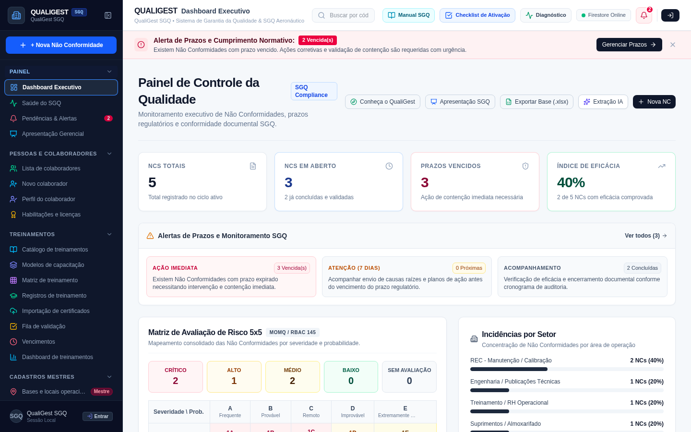
</p>

---

## 1. Nome e Apresentação do QualyQuest / Rooster

O ecossistema **QualyQuest SGQ & Rooster MRO Enterprise** é a solução definitiva de software integrada para oficinas de manutenção aeronáutica homologadas sob os regulamentos **ANAC RBAC 145**, **EASA Part-145**, **FAA Part 145**, **ISO 9001:2015** e **AS9100**.

O sistema opera a partir da fusão arquitetural e operacional de dois pilares complementares:
1. **Rooster MRO Enterprise — Sistema Mestre de Registro (System of Record):** Estabelecido como fonte canônica e imutável para gestão de Pessoas (`persons`), Catálogo Oficial de Cursos por Frota/Motor (`trainingCourses`), Registros de Treinamentos e Reciclagens (`trainingRecords`), Licenças e Habilitações ANAC (`qualifications`) e Bases Operacionais (`operational_bases`).
2. **QualyQuest SGQ — Motor Integrado da Qualidade & Governança:** Plataforma de gestão do Sistema de Garantia da Qualidade, gerenciando Não Conformidades (RNC Formulário F 001-29), Matriz de Risco Aeronáutico 5x5, Análise Causal (Ishikawa 6M e 5 Porquês), Planos Corretivos 5W2H, Acervo Documental com Consulta Temporal na data da OS, Gestão Metrológica de Ferramentas (RBAC 145.109), Auditorias por Requisitos e Apresentações Gerenciais 70/30.

---

## 2. Finalidade do Sistema

A finalidade central do QualyQuest / Rooster é garantir a **aeronavegabilidade continuada e a segurança de voo** por meio da conformidade técnica e regulatória ininterrupta das operações de manutenção:
- **Blindagem Operacional:** Impedir que aeronaves sejam liberadas para voo (*Return to Service - RTS* ou *Certificado de Liberação de Aeronave - CRS*) por técnicos com habilitações, carteiras CHT ou reciclagens regulamentares vencidas.
- **Rastreabilidade Ininterrupta:** Assegurar que qualquer manutenção realizada no passado possa ser reconstituída formalmente, comprovando qual técnico executou o serviço, quais ferramentas calibradas na RBC foram utilizadas e qual a revisão exata do manual do fabricante estava legalmente vigente no dia da Ordem de Serviço.
- **Governança Executiva:** Fornecer à Diretoria, Responsáveis Técnicos e Gerentes da Qualidade um espelho fidedigno e auditável em tempo real sobre a saúde do SGQ, sem aproximações fictícias ou extrapolações não comprovadas.

---

## 3. Problemas Operacionais Resolvidos

| Problema Operacional Tradicional no MRO | Consequência Regulatória | Solução QualyQuest / Rooster MRO |
| :--- | :--- | :--- |
| **Planilhas Isoladas de Treinamentos** | Divergência entre bases, registros desatualizados e turmas expiradas. | **Rooster MRO como Fonte Canônica Centralizada:** Base única multi-tenant no Firestore com cálculo preditivo e atualização em tempo real. |
| **Presunção Arbitrária de Validade** | Atribuição indiscriminada de 730 ou 1825 dias para cursos sem regra documentada. | **5 Estados de Validade Estritos:** Distinção matemática entre sem vencimento aplicável, sem validade definida, dados insuficientes, em dia e vencido. |
| **Uso de Manuais Técnicos Obsoletos** | Infração gravíssima do RBAC 145.109 por utilizar cartões de trabalho desatualizados. | **Consulta Temporal na Data da OS:** Algoritmo que audita qual revisão do AMM/CMM/MOE estava em vigor no exato dia da execução do serviço. |
| **Ferramentas com Calibração Vencida** | Comprometimento legal do certificado de liberação de aeronave (CRS). | **Conta Corrente de Créditos Metrológicos (RBC):** Alerta antecipado aos 30 e 60 dias e segregação em quarentena com trava física e digital. |
| **Falsos Sucessos de Gravação Offline** | Dados perdidos por falhas transitórias de conexão simuladas como gravadas. | **Persistência Real Comprovada:** O sistema jamais confirma uma gravação sem validação remota definitiva do Firestore (`savePessoa()` e equivalentes). |
| **Silos Departamentais** | A qualidade não conversa com o almoxarifado, planejamento ou RH operacional. | **Cadeia Circular em 15 Fases Integradas:** Do requisito do cliente e auditoria externa à competência do técnico e lição aprendida corporativa. |

---

## 4. Principais Funcionalidades Implementadas

- **Fluxo Digital de Não Conformidades (F 001-29):** Digitalização com numeração única e auditável, triagem de ação preventiva/corretiva, verificação de eficácia de 60 dias e bloqueio de encerramento sem evidência comprovada.
- **Matriz de Risco Aeronáutico 5x5:** Severidade (1 a 5) versus Probabilidade (A a E) com cálculo estrito de pontuação e segregação de ocorrências na faixa crítica P1.
- **Metodologia Causal Estruturada:** Integração do Diagrama de Ishikawa 6M (Método, Mão de Obra, Máquina, Material, Meio Ambiente, Medição) com a técnica dos 5 Porquês e planos 5W2H.
- **Rooster MRO — Pessoas, Competências & CHTs:** Visão 360° do colaborador técnico, especialidades (Célula, Grupo Motopropulsor, Aviônica), restrições físicas/operacionais e controle de assinaturas.
- **Catálogo de Cursos & Matrizes por Frota/Motor:** Requisitos mandatórios por aeronave (A320, B737, B767, B777, ATR, Caravan, King Air) e motor (CFM56, LEAP, V2500, Trent, GE90, PT6A).
- **Central Preditiva de Vencimentos & Gaps:** Filtros dinâmicos por faixas temporais (≤30 dias, ≤60 dias, ≤90 dias) e identificação de lacunas técnicas por posto de trabalho.
- **Governança Documental & Consulta Temporal (Fase 10):** Catálogo de publicações controladas com histórico de revisões vigentes e motor de busca temporal para auditorias ANAC/EASA.
- **Metrologia & Ferramental Calibrado (RBAC 145.109):** Conta de créditos de calibração, controle de laudos RBC vinculados e quarentena para instrumentos com crédito esgotado.
- **Apresentação Gerencial 70/30 (Web & PPTX Auto-Fit):** Relatório oficial com 20+ slides vetoriais, proporção 70% Situação Real / 30% Evolução Sistêmica, cálculo dinâmico de fontes e margem mínima de 0.20" garantida.
- **Auditoria Inteligente por Requisitos (Fase 13):** Arquitetura "Um Controle, Vários Requisitos" com checklist Kalitta Air QA-14 / EASA / ANAC e confirmação em lote por exceção.
- **System Designer Permanente & ADRs (Fase 14):** Catálogo vivo de Decisões Arquiteturais de Software (Architecture Decision Records) documentadas e rastreáveis.
- **Motor Smart Import em 4 Etapas (Fase 15):** Carga assistida de planilhas com mapeamento inteligente, diff visual de reconciliação (novo, atualizado, idêntico) e botão seguro de reversão (Undo).

---

## 5. Módulos Disponíveis (9 Domínios Canônicos)

A navegação do sistema é unificada em um menu lateral persistente estruturado em **9 domínios canônicos**, com submenus expansíveis e controle de rotas sem pontas soltas:

```
QualyQuest SGQ & Rooster MRO Enterprise
├── [+ Nova Não Conformidade] (Ação Primária Instantânea)
├── 1. PAINEL
│   ├── Dashboard Executivo (Visão Geral de RNCs, Matriz 5x5 e Alertas)
│   ├── Saúde do SGQ (Índice sgqHealth e Maturidade Regulatória)
│   ├── Pendências & Alertas Críticos (Fila com Contadores em Tempo Real)
│   └── Apresentação Gerencial (Viewer Oficial SSoT 20 Slides 70/30)
├── 2. PESSOAS E COLABORADORES (Rooster MRO)
│   ├── Colaboradores (Lista Oficial, Filtros por Base e Status Operacional)
│   ├── Novo Colaborador (Cadastro com Validação Remota Obrigatória)
│   ├── Perfil do Colaborador (Dossiê Técnico Roster e Vínculos)
│   ├── Habilitações & Licenças (Carteiras CHT ANAC, FAA e Autorizações RTS)
│   └── Painel de Competências Técnicas (Proficiência por Especialidade)
├── 3. TREINAMENTOS (Rooster MRO)
│   ├── Catálogo de Cursos (Recorrência, Cargas Horárias e Frotas)
│   ├── Modelos de Capacitação (Requisitos Formais por Cargo/Função)
│   ├── Matriz de Treinamentos (Mapas de Cobertura por Frota e Motor)
│   ├── Registros de Treinamento (Histórico de Execução com 5 Estados)
│   ├── Importação de Certificados (Carga em Lote de Treinamentos)
│   ├── Fila de Validação — Certificados (Triagem Técnica DHO)
│   ├── Fila de Validação — Qualidade (Homologação SGQ)
│   ├── Central de Vencimentos & Gaps (Monitoramento Preditivo ≤30/60/90d)
│   └── Dashboard de Treinamentos (Indicadores Agregados de Efetivo)
├── 4. CADASTROS MESTRES (Rooster MRO como Fonte Canônica)
│   ├── Bases e Locais Operacionais (Hubs, Linha e Sites / Status e Vínculos)
│   ├── Funções e Cargos (Especialidades Técnicas e Requisitos Mínimos)
│   ├── Motores & Frota (Catálogo de Modelos CFM56, V2500, GE90, Trent, PT6A)
│   └── Parâmetros Necessários ao Fluxo (Regras de Tolerância e Prazos)
├── 5. QUALIDADE E CONTROLES
│   ├── Não Conformidades (Fluxo Digital F 001-29 / 6M + 5 Porquês + 5W2H)
│   ├── Análise & Indicadores (Pareto 80/20, MTTR e Capítulos ATA 100)
│   ├── Validação & Aprovação (Fila de Maturação N1 a N5)
│   ├── Auditorias Internas & Externas (ANAC, EASA, FAA e Clientes)
│   ├── Auditoria Inteligente & Clientes (Checklist Kalitta QA-14 / Exceção)
│   ├── Acervo & Revisões (Controle Documental & Consulta Temporal na OS)
│   └── Ferramentas & Metrologia (Calibração RBC & Conta de Créditos)
├── 6. RELATÓRIOS
│   ├── Relatório do Roster (Exportação Oficial A4 e Excel)
│   ├── Dossiê Oficial F 001-29 (Ficha Técnica para Auditoria Externa)
│   ├── Histórico Documental (Pareceres de Vigência Temporal na OS)
│   ├── Constatações de Auditoria (Findings e Prazos Regulatórios)
│   └── Conferência de Frota & Pré-Turno (Prontidão Operacional)
├── 7. ADMINISTRAÇÃO E SEGURANÇA
│   ├── Usuários & Permissões RBAC (Admin, Gestor, Auditor, Consulta)
│   ├── Configurações Organizacionais (Tenant, Identidade Corporativa)
│   ├── System Designer Permanente (Catálogo Oficial de ADRs)
│   └── Diagnósticos Técnicos (Arquitetura, Health Check e Infraestrutura)
├── 8. AUDITORIA E HISTÓRICO
│   └── Audit Trail do Sistema (Trilha de Auditoria Imutável Append-Only)
└── 9. CONFIGURAÇÕES E FERRAMENTAS
    ├── Importação Inteligente de Dados (Wizard em 4 Etapas com Undo)
    ├── Extrator de NCs com IA (Leitura de DOCX, PDF e Imagens)
    ├── Base de Conhecimento SGQ (Lições Aprendidas N1-N5)
    └── Manual de Utilização (35 Capítulos Oficiais Integrados)
```

---

## 6. Gestão de Colaboradores e Efetivo Técnico

O cadastro de pessoas é governado exclusivamente pelo módulo **Rooster MRO**, armazenado na coleção canonical `/organizations/{orgId}/persons`:
- **Campos Obrigatórios:** Nome completo, matrícula funcional única, cargo operacional, especialidade técnica, data de admissão, base operacional e status.
- **Segregação Rigorosa de Status:**
  - `ATIVO`: Plena aptidão operacional e contratual.
  - `EM_TREINAMENTO`: Em integração prática ou supervisão on-the-job no hangar.
  - `RESTRITO`: Restrição médica ou técnica ativa (bloqueio automático de liberação de voo no SGQ).
  - `SUSPENSO`: Bloqueio cautelar administrativo ou disciplinar.
  - `AFASTADO`: Licença previdenciária, médica ou temporária.
  - `INATIVO` / `DESLIGADO`: Histórico preservado para rastreabilidade de ordens de serviço passadas.
  - `STATUS_NAO_INFORMADO`: Registros migrados que demandam triagem cadastral.

---

## 7. Treinamentos, Habilitações e Qualificações (CHT)

O sistema gerencia o ciclo integral de habilitações aeronáuticas:
- **Licenças Técnicas ANAC (CHTs):** Carteiras de Célula (CEL), Grupo Motopropulsor (GMP) e Aviônica (AVI), com número CANAC, data de emissão, data de validade e anexos digitais.
- **Autorizações RTS (Return to Service):** Credenciamento interno da organização para liberação de tipos específicos de aeronaves e limites de manutenção (ex: inspeções de até 100 horas, pré-voo, trânsito).
- **Renovação Não-Destrutiva:** Toda renovação de treinamento ou licença gera um novo registro vinculado ao registro anterior via `registroOrigemId` e `registroSubstitutoId`, preservando a rastreabilidade histórica completa sem sobrescrever dados anteriores.

---

## 8. Catálogo de Cursos e Modelos de Capacitação

O catálogo de treinamentos (`trainingCourses` / `rooster-catalogo`) padroniza a matriz curricular da oficina:
- **Estruturação por Frotas:** Frotas comerciais (Airbus A320, A330, Boeing 737, 767, 777), regionais (ATR 42/72) e executivas (Cessna Caravan C208, Beechcraft King Air).
- **Módulos por Nível:**
  - *Nível 1 — Familiarização Geral:* Arquitetura básica, zonas da aeronave e precauções de segurança.
  - *Nível 2 — Ramp & Transit:* Operações de trânsito, checagens de linha e sistemas principais.
  - *Nível 3 — Line & Base Maintenance:* Manutenção pesada de hangar, remoção/instalação de componentes e diagnósticos profundos de falha (*troubleshooting*).
- **Modelos de Capacitação:** Matrizes que estabelecem o pacote mínimo de treinamentos mandatórios para cada cargo (Mecânico de Pátio, Mecânico de Hangar, Inspetor da Qualidade, Especialista em Ensaios Não Destrutivos - NDT).

---

## 9. Controle de Validade e Recorrência (5 Estados)

A determinação de validade de treinamentos e habilitações obedece rigorosamente ao **motor matemático de 5 estados**, sem suposições arbitrárias:

```
┌────────────────────────────────────────────────────────────────────────┐
│                      MATRIZ DOS 5 ESTADOS DE VALIDADE                  │
├──────────────────────────────┬─────────────────────────────────────────┤
│ 1. Sem vencimento aplicável  │ Regra explícita cadastrada:             │
│                              │ curso permanente / sem_validade: true   │
├──────────────────────────────┼─────────────────────────────────────────┤
│ 2. Sem validade definida     │ Ausência de periodicidade sem regra     │
│                              │ explícita (requer análise de engenharia)│
├──────────────────────────────┼─────────────────────────────────────────┤
│ 3. Dados insuficientes       │ Registro sem data de realização         │
│                              │ ou campos mandatórios incompletos       │
├──────────────────────────────┼─────────────────────────────────────────┤
│ 4. Em dia                    │ Validade futura calculada por meses     │
│                              │ exatos de calendário ou data explícita  │
├──────────────────────────────┼─────────────────────────────────────────┤
│ 5. Vencido                   │ Data de validade menor que a data       │
│                              │ de referência atual (bloqueio ativo)    │
└──────────────────────────────┴─────────────────────────────────────────┘
```

> **Regras Absolutas:**
> - A ausência de periodicidade no catálogo **jamais** é convertida automaticamente em "sem vencimento".
> - É terminantemente proibido arbitrar prazos fictícios de 730 ou 1825 dias.
> - O cálculo de meses adiciona meses reais de calendário sobre a data de realização, sem aproximação por buckets fixos de 30 dias.
> - Se houver data de validade explicitamente cadastrada no registro original, ela tem precedência soberana sobre o cálculo derivado.

---

## 10. Governança Documental e Consulta Temporal na Data da OS

O módulo de Controle Documental (Fase 10 / Coleção `/manuals` e `/documentosControlados`) atende ao RBAC 145.109:
- **Acervo Vigente:** Gestão do acervo de Manuais de Procedimentos (MOE/MPM), Manuais de Manutenção (AMM), Manuais de Revisão de Peças (CMM) e Manuais do SGQ.
- **Máquina Temporal Regulatória:** Permite ao auditor ou perito selecionar qualquer data do passado e consultar instantaneamente:
  - Qual manual estava aprovado e vigente naquele exato dia;
  - Qual era a revisão legal em vigor;
  - Histórico de aprovações com parecer técnico em PDF pronto para auditorias de autoridades aeronáuticas.

---

## 11. Consultas, Indicadores e Dashboards

- **Índice de Saúde do SGQ (`sgqHealth`):** Algoritmo ponderado de maturidade operacional que analisa pontualidade de ações 5W2H, severidade na Matriz 5x5, vigência documental e habilitações CHT.
- **Painel Executivo da Qualidade:** Indicadores em tempo real com distribuição de desvios por setor, causas raízes mais frequentes e eficácia comprovada de soluções.
- **Central de Vencimentos & Gaps:** Visão consolidada em colunas de urgência (≤30 dias, ≤60 dias, ≤90 dias) e tabela analítica por colaborador.
- **Apresentação Gerencial Oficial 70/30 (Web e PPTX):**
  - *Parte I (Slides 1 a 14 - 70%):* Espelho da situação real da empresa (RNCs F 001-29, Ishikawa 6M, 5 Porquês, 5W2H, Pessoas/CHTs, Documentos na data da OS, Metrologia RBC, Alertas e Decisões Imediatas).
  - *Parte II (Slides 15 a 20+ - 30%):* Governança tecnológica e evolução contínua (Ecossistema de 15 fases, Régua de Maturidade N1 a N5, Status de Homologação, Roadmap H1 a H4, Parecer da Qualidade e Metadados com hash de integridade).
  - *Homologação PPTX:* Arquivo `.pptx` widescreen (16:9) gerado dinamicamente com garantia geométrica de **Zero Overflows** e respeito integral à Safe Area (margem para rodapé ≥ 0.20").

---

## 12. Integrações Existentes e APIs

### Conectores Server-Side (Impacto MRO Connect)
Disponíveis através do servidor seguro Node.js Express (`server.ts`) na porta 3000:
- `GET /api/impacto/health`: Health check de conectividade da infraestrutura.
- `GET /api/impacto/colaboradores`: Efetivo técnico ativo e status operacional.
- `GET /api/impacto/ferramentas`: Ferramental calibrado e status RBC.
- `GET /api/impacto/aeronaves`: Frotas e modelos atendidos no hangar.
- `GET /api/impacto/ordens-servico`: Ordens de Serviço ativas e concluídas.
- `GET /api/impacto/ordens-servico/:id/contexto-qualidade`: Dossiê consolidado de qualidade da OS cruzando técnico executor, ferramentas aplicadas e manuais consultados.

### Segurança de Chaves e Inteligência Artificial
A integração com o **Google Gemini AI** opera exclusivamente do lado do servidor via `@google/genai` utilizando `process.env.GEMINI_API_KEY`. Nenhuma chave ou credencial é exposta no cliente Web.

---

## 13. Perfis de Acesso e Regras de Segurança Firestore

A persistência do sistema é protegida pelas regras estritas de `firestore.rules`:

```
┌────────────────────────────────────────────────────────────────────────┐
│                      MATRIZ DE PERMISSÕES RBAC                         │
├───────────────┬────────────────────────────────────────────────────────┤
│ Administrador │ Leitura e escrita completas em todas as coleções       │
│               │ corporativas, gerenciamento de usuários e regras.      │
├───────────────┼────────────────────────────────────────────────────────┤
│ Gestor        │ Criação e edição de RNCs, Pessoas, Treinamentos,       │
│               │ Manuais e Metrologia; aprovação formal de ações.       │
├───────────────┼────────────────────────────────────────────────────────┤
│ Auditor       │ Leitura irrestrita de registros, relatórios, evidências│
│               │ e trilhas de auditoria; emissão de constatações.       │
├───────────────┼────────────────────────────────────────────────────────┤
│ Consulta      │ Leitura restrita aos dashboards e consultas da sua     │
│               │ própria organização; gravação e edição BLOQUEADAS.     │
└───────────────┴────────────────────────────────────────────────────────┘
```

> **Blindagens Ativas de Segurança:**
> - Usuários autenticados sem perfil atribuído em `/users/{userId}` têm acesso sumariamente negado a dados de organizações.
> - A leitura de `/organizations/{organizationId}` é estritamente restrita a usuários com perfil associado ao respectivo tenant.
> - Operações de listagem (`list`) em `/users` e `/userInvitations` são filtradas por organização com exigência de privilégio administrativo.
> - Eliminação de qualquer exceção ou brecha para organização com `getUserOrgId()` vazio.

---

## 14. Arquitetura Tecnológica Real

- **Framework Web:** React 19 SPA rodando sobre Vite 6 com suporte a TypeScript em modo estrito.
- **Backend / Proxy de API:** Node.js 22 + Express 4 (`server.ts`) montado com `vite.middlewares` no ambiente de desenvolvimento.
- **Banco de Dados em Nuvem:** Google Cloud Firestore (SDK Firebase 12) operando como SSoT com listeners `onSnapshot`.
- **Estilização e Design System:** Tailwind CSS v4, componentes responsivos com suporte nativo ao Modo Escuro aeronáutico e ícones Lucide React.
- **Visualização de Dados:** Gráficos interativos em Recharts e geração nativa de apresentações corporativas com PptxGenJS.
- **Geração de Documentos:** jsPDF, html2canvas e biblioteca interna de exportação A4.

---

## 15. Instalação e Execução

### Pré-requisitos
- Node.js 20+ ou 22+
- Gerenciador de pacotes npm

### Passos de Instalação

```bash
# 1. Clonar o repositório
git clone https://github.com/seu-repositorio/qualyquest-rooster.git
cd qualyquest-rooster

# 2. Instalar dependências
npm install

# 3. Configurar variáveis de ambiente
cp .env.example .env

# 4. Executar o servidor de desenvolvimento (Porta 3000)
npm run dev
```

### Comandos de Build e Verificação

```bash
# Validação de tipos TypeScript
npm run lint

# Execução da suíte completa de testes de integração (81 testes)
npm run test:integration

# Teste de homologação geométrica extrema da apresentação PPTX (35 slides)
npx tsx scripts/homologation-fase12-3.ts

# Geração física do arquivo PPTX oficial
npx tsx scripts/generate_official_pptx.ts

# Compilação para produção
npm run build

# Execução do bundle de produção
npm run start
```

---

## 16. Configuração de Ambiente

Crie o arquivo `.env` na raiz do projeto com base no arquivo `.env.example`:

```env
# Porta do servidor integrado Express + Vite (padrão: 3000)
PORT=3000

# Chave de API Google Gemini (protegida exclusivamente no servidor)
GEMINI_API_KEY=sua_chave_aqui

# Configuração do Firebase Client (acessível via Vite)
VITE_FIREBASE_API_KEY=sua_api_key
VITE_FIREBASE_AUTH_DOMAIN=seu_projeto.firebaseapp.com
VITE_FIREBASE_PROJECT_ID=seu_projeto_id
VITE_FIREBASE_STORAGE_BUCKET=seu_projeto.appspot.com
VITE_FIREBASE_MESSAGING_SENDER_ID=seu_sender_id
VITE_FIREBASE_APP_ID=seu_app_id
```

---

## 17. Testes Disponíveis e Situação Conhecida

O repositório conta com baterias automatizadas de testes e rotinas de validação:

| Eixo de Teste | Arquivo / Comando | Qtd Testes | Situação |
| :--- | :--- | :---: | :---: |
| **1. Segurança Firestore** | `npm run test:integration` | 18 | 🟢 **PASS (100%)** |
| **2. Persistência Real** | `npm run test:integration` | 6 | 🟢 **PASS (100%)** |
| **3. Regras de Validade (5 Estados)** | `npm run test:integration` | 12 | 🟢 **PASS (100%)** |
| **4. Navegação e Rotas Reais** | `npm run test:integration` | 35 | 🟢 **PASS (100%)** |
| **5. Integridade Referencial** | `npm run test:integration` | 10 | 🟢 **PASS (100%)** |
| **Estresse Geométrico PPTX (Fase 12.3)** | `npx tsx scripts/homologation-fase12-3.ts` | 35 slides | 🟢 **PASS (0 Overflows)** |
| **Geração de Arquivo PPTX Oficial** | `npx tsx scripts/generate_official_pptx.ts` | 24 slides | 🟢 **PASS (616 elementos)** |
| **Compilação TypeScript** | `npm run lint` (`tsc --noEmit`) | Código Geral | 🟢 **PASS (0 erros)** |
| **Emulador Local Firestore (Testes Unitários)** | `firebase emulators:exec` | — | 🟡 **NÃO EXECUTADO** (Ambiente CI sem Java Runtime / JRE) |

---

## 18. Limitações Atuais

1. **Ambiente de Emulador Local sem JRE:** O contêiner de desenvolvimento e integração contínua não dispõe de Java Runtime Environment (JRE) instalado para execução direta do binário do Firebase Emulator local; a segurança foi homologada através de auditoria estática rigorosa das regras e testes de conexão com a API real do Firestore.
2. **Integrações de ERP em Estágio de Conectores:** Os conectores com sistemas de terceiros como SAP, Totvs e Quantum estão definidos via contratos de API na camada proxy, com homologação de conectores em andamento para ambientes legados de produção.

---

## 19. Funcionalidades em Homologação e Desenvolvimento

- **Homologação dos Endpoints Proxy `/api/impacto/*`:** Testes de carga e resiliência em lote para sincronização contínua de ordens de serviço e ferramental.
- **Conferência de Turno de Linha:** Expansão das rotinas de conferência de pré-turno e prontidão física de técnicos no pátio de manobras.

---

## 20. Roadmap Estratégico e Próximas Etapas

```
┌────────────────────────────────────────────────────────────────────────┐
│                   HORIZONTES DE EVOLUÇÃO ESTRATÉGICA                   │
├────────────────────┬───────────────────────────────────────────────────┤
│ Horizonte 1        │ 🟢 100% Homologado em Produção                    │
│ Core Consolidado   │ RNC F 001-29, 6M/5W2H, Rooster MRO (Pessoas,      │
│                    │ Treinamentos, 5 Estados, Bases), Consulta Temporal│
│                    │ Metrologia RBC, Apresentação 70/30, ADRs e Import │
├────────────────────┼───────────────────────────────────────────────────┤
│ Horizonte 2        │ 🟡 Em Homologação / Andamento                     │
│ Conectores & ERPs  │ API Impacto MRO Connect, Diário de Bordo          │
│                    │ Eletrônico (ELB), integração SAP / Totvs / Quantum│
├────────────────────┼───────────────────────────────────────────────────┤
│ Horizonte 3        │ 🔵 Planejado (Médio/Longo Prazo)                  │
│ Predição ATA 100   │ Modelagem probabilística de falhas de frota,      │
│                    │ confiabilidade estocástica e alertas de AD/DA     │
├────────────────────┼───────────────────────────────────────────────────┤
│ Horizonte 4        │ ⚪ Visão de Longo Prazo                           │
│ Ecossistema Global │ Rede colaborativa inter-MRO de lições aprendidas  │
│                    │ anonimizadas e benchmarking de segurança de voo   │
└────────────────────┴───────────────────────────────────────────────────┘
```

---

## 21. Screenshots Reais da Aplicação

Todas as imagens a seguir foram capturadas diretamente da aplicação em execução no ambiente local (`http://localhost:3000`), refletindo a interface autêntica do QualyQuest / Rooster MRO:

### 21.1. Painel Executivo / Dashboard SGQ
*Visão macro de indicadores da qualidade, distribuição de Não Conformidades por fase, matriz de risco aeronáutico 5x5, desvios por setor e fila de alertas.*


---

### 21.2. Lista de Colaboradores e Efetivo Técnico (Rooster MRO)
*Quadro mestre de técnicos e mecânicos com matrícula, CANAC, base operacional, status de prontidão e filtros avançados por cargo e setor.*
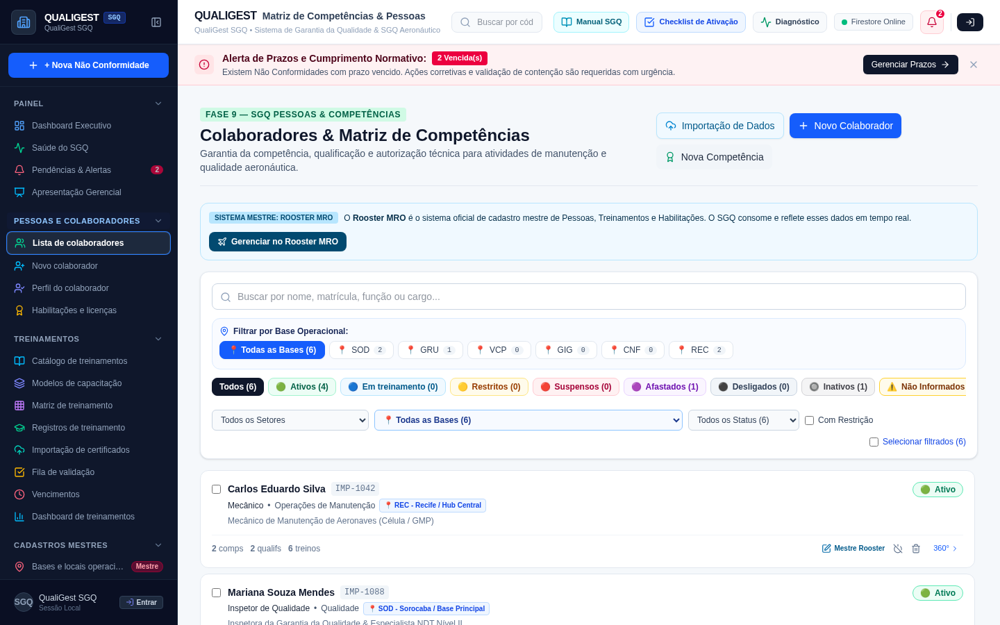

---

### 21.3. Dossiê do Mecânico / Perfil do Colaborador
*Ficha técnica individual com carteiras CHT, registros de treinamentos mandatórios, autorizações de liberação (RTS) e controle de restrições.*
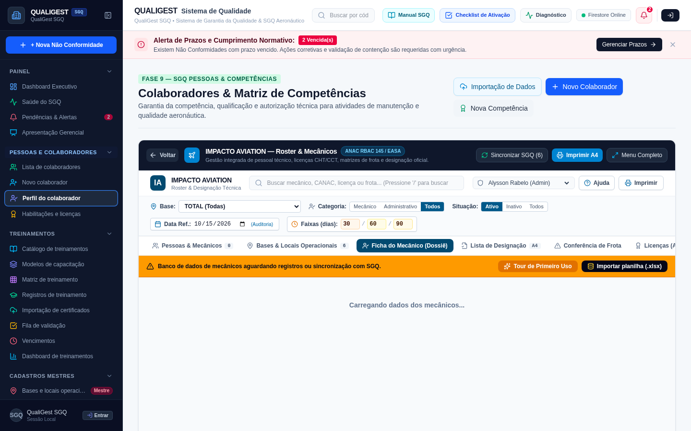

---

### 21.4. Registros de Treinamentos e Qualificações
*Histórico regulamentar de cursos realizados com aplicação rigorosa dos 5 estados de validade, vínculos de renovação e anexos comprobatórios.*
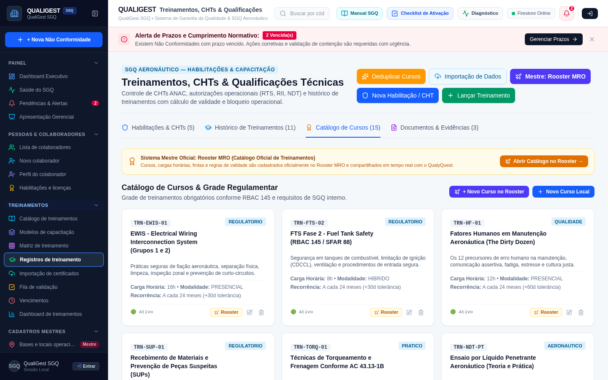

---

### 21.5. Catálogo Oficial de Cursos e Treinamentos
*Estruturação curricular por frotas (Airbus, Boeing, ATR, Cessna, King Air) e motores, com níveis de formação e regras de recorrência.*
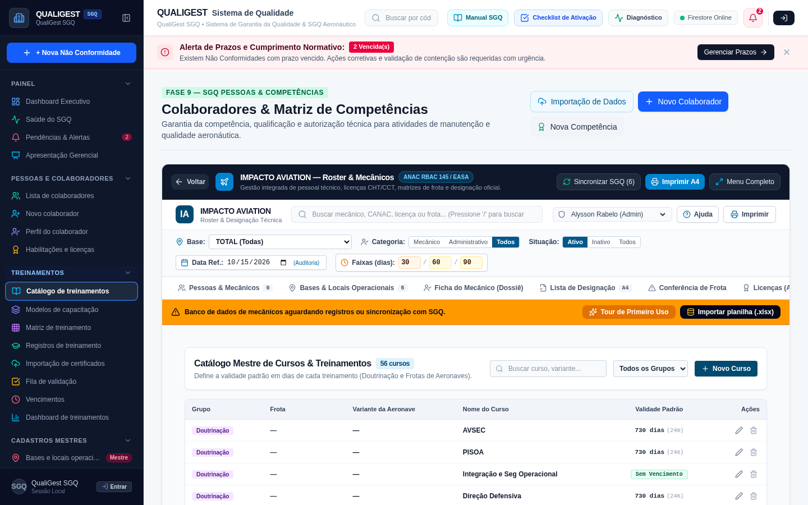

---

### 21.6. Matriz de Treinamentos por Frota e Motor
*Cruzamento visual entre o corpo técnico e os requisitos de certificação por modelo de aeronave e motorização aeronáutica.*
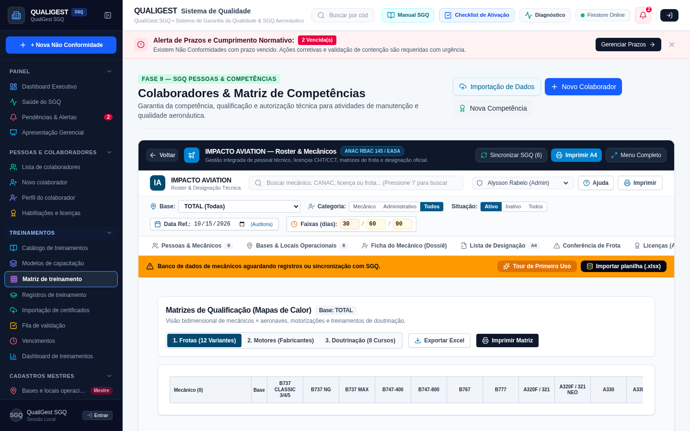

---

### 21.7. Modelos de Capacitação Operacional por Cargo
*Configuração padronizada das competências e treinamentos mínimos exigidos para cada função e posto técnico de trabalho na oficina.*
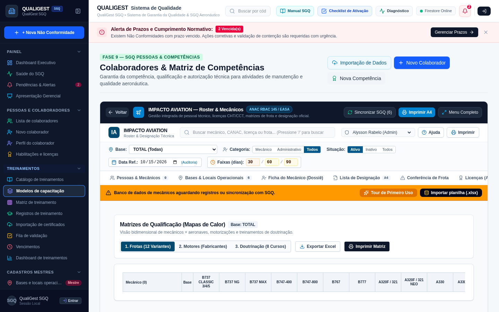

---

### 21.8. Central Preditiva de Vencimentos & Gaps
*Monitoramento antecipado de expirações em colunas de urgência temporal (≤30 dias, ≤60 dias, ≤90 dias) e detecção de lacunas de qualificação.*
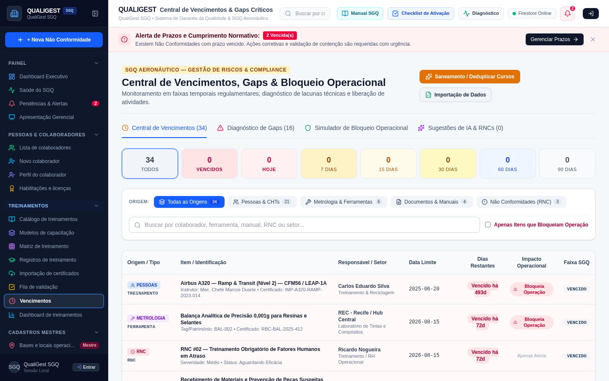

---

### 21.9. Bases e Locais Operacionais
*Cadastro mestre de instalações e aeroportos com segregação entre Hubs Centrais, Estações de Linha e Sites Remotos de Atendimento.*
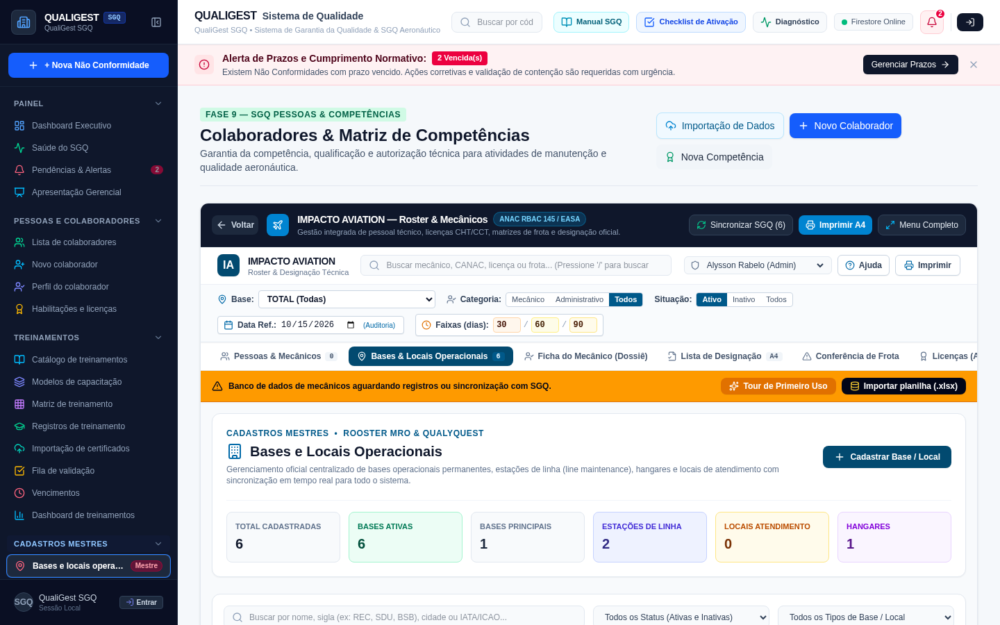

---

### 21.10. Gestão de Não Conformidades (Formulário RNC F 001-29)
*Módulo de tratamento de desvios com metodologia 6M de Ishikawa, 5 Porquês, matriz de risco 5x5 e planos de ação corretiva 5W2H.*
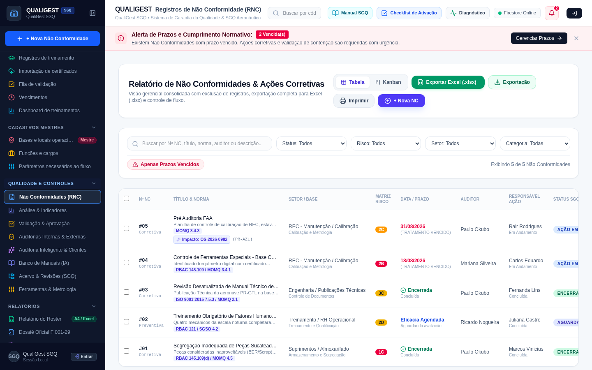

---

### 21.11. Controle Documental e Consulta Temporal na Data da OS
*Acervo normativo de manuais técnicos com mecanismo cronológico de busca para comprovação da revisão vigente no dia da execução da ordem de serviço.*
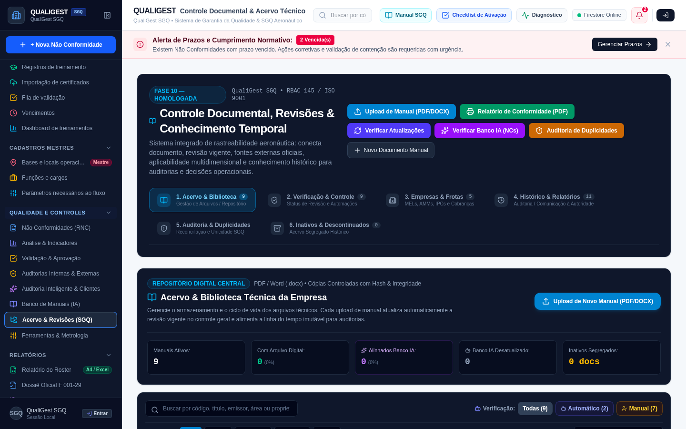

---

### 21.12. Apresentação Gerencial Oficial 70/30 (Web Viewer & PPTX)
*Visualizador corporativo em formato widescreen (16:9) com 24 slides estruturados e botão de exportação para arquivo PowerPoint auditável.*
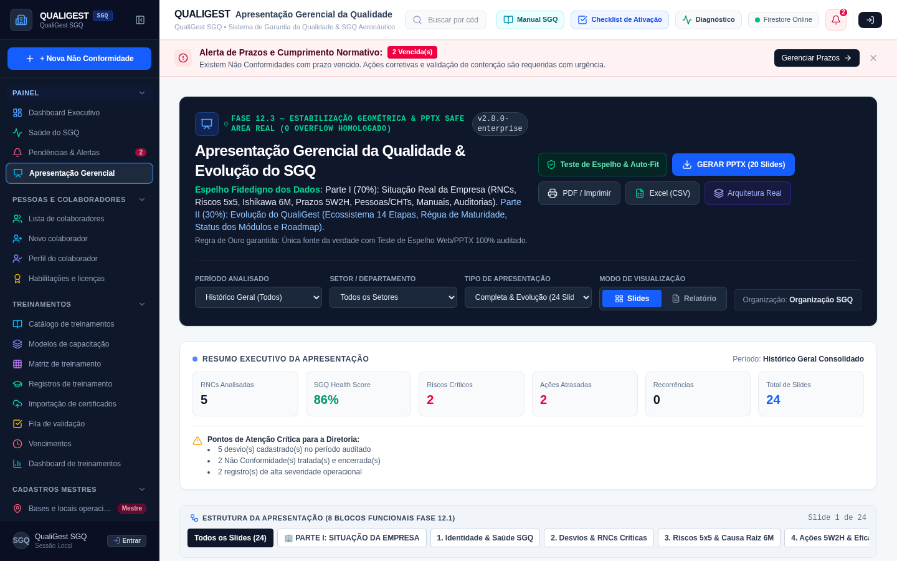

---

## 22. Apresentação Executiva em PowerPoint (.pptx)

O sistema disponibiliza o arquivo PPTX oficial pronto para apresentação perante diretorias, comitês executivos e auditorias regulatórias:
- **Download do PPTX:** O arquivo encontra-se compilado na pasta [`docs/Apresentacao_Gerencial_QualyQuest_Rooster.pptx`](./docs/Apresentacao_Gerencial_QualyQuest_Rooster.pptx) e na pasta pública [`public/Apresentacao_Gerencial_QualyQuest_Rooster.pptx`](./public/Apresentacao_Gerencial_QualyQuest_Rooster.pptx).
- **Homologação:** 24 slides em conformidade estrita com o Safe Area widescreen, testados sob estresse extremo com **0 infrações de overflow**.

---

<div align="center">
  <sub>QualyQuest SGQ & Rooster MRO Enterprise • Excelência Técnica em Manutenção Aeronáutica e Segurança de Voo</sub>
</div>
